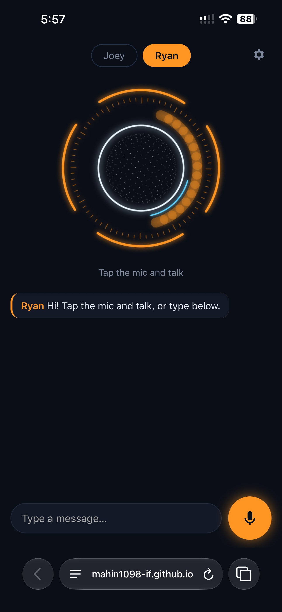
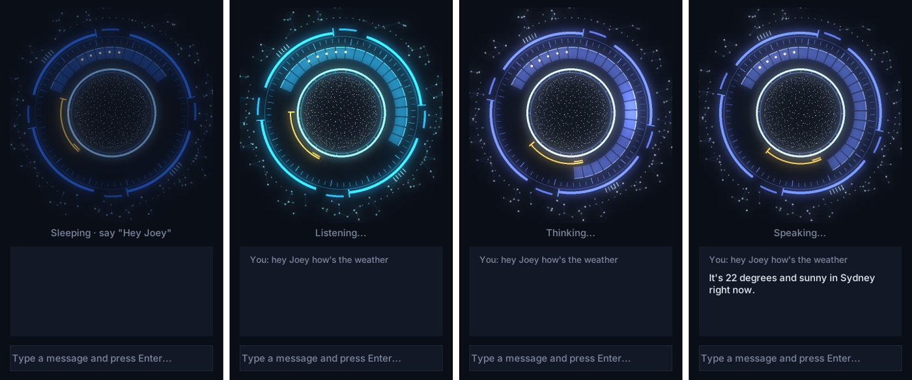

# Joey & Ryan — a personal AI assistant

A JARVIS-style voice assistant with two characters: **Joey** (calm, warm) and **Ryan** (confident, dry humour).
Say "Hey Joey" or "Hey Ryan", ask anything, and they answer out loud. They can hand over to each other,
or even debate a topic between themselves.

It runs in two places:

| | **Desktop app** (Windows, Python) | **Phone app** |
|---|---|---|
| How it runs | Always-on app on the PC, starts with Windows | Web app added to the iPhone home screen |
| Wake word | "Hey Joey" / "Hey Ryan" | Tap the mic |
| Voice | Natural offline voices (Piper) | The phone's built-in voices |
| Works away from home | — | ✅ anywhere with internet |

**Try the phone app:** https://mahin1098-if.github.io/AI-Assistant/ (needs your own Claude API key, which stays on your device).

<p>
  
  &nbsp;
  
</p>

▶ [Watch the desktop app talking](joey_hud_demo.mp4)

## Features

- **Two characters, one assistant** — each with its own personality, voice, colour and conversation memory. "Switch to Ryan" hands the conversation over.
- **Joey & Ryan talk to each other** — "debate pineapple on pizza" or "brainstorm a birthday gift" starts a back-and-forth between the two.
- **Live web answers** — current events, prices and facts are searched on the web, with clickable sources.
- **Long-term memory** — "remember my sister's birthday is 3 May"; they remember across sessions until told to forget.
- **Morning briefing** *(desktop)* — weather, today's calendar and top headlines, split between both characters.
- **PC control** *(desktop)* — open apps, play music, set timers, take notes, draft WhatsApp messages and emails, read your Google Calendar.
- **Screen help** *(desktop)* — "what's this error on my screen?" takes a screenshot and explains it.
- **HUD interface** — an animated ring that pulses in time with the voice.
- **Remote access** *(desktop)* — talk to the PC version from your phone over home Wi-Fi (self-signed HTTPS) or a private Telegram bot.

## How it works

```
 Mic ──► Speech-to-text ──► Wake word / router ──► Claude (tool use loop) ──► Text-to-speech ──► Speaker
                              │  Joey or Ryan?          │
                              │  handoff? debate?       ├─ web search (server tool)
                              │  briefing?              ├─ weather, time
                                                        ├─ memory (remember / forget)
                                                        └─ desktop only: apps, music, timers,
                                                           calendar, news, messages, screenshot
```

- **Brain:** Anthropic Claude API with tool use. Each character has its own system prompt and history. A manual tool loop runs the tools Claude asks for and sends the results back; Claude's server-side web search adds cited sources.
- **Speed tricks:** the next line of a Joey–Ryan debate is generated while the current one is being spoken; the morning briefing gathers weather, calendar and news in parallel.
- **Phone app:** a single-file web app (HTML/CSS/JavaScript, no framework, no server). It calls the Claude API directly from the browser, uses the browser's speech recognition and speech synthesis, and stores settings and memory in `localStorage`. Hosted free on GitHub Pages.
- **Desktop voice:** microphone capture with automatic background-noise calibration, Google speech recognition, and Piper neural text-to-speech, with the HUD synced to the audio.

## What's in this repository

| Folder / file | What it is |
|---|---|
| `index.html`, `manifest.webmanifest`, `icon-*.png` | The phone app (served by GitHub Pages) |
| `desktop/` | The Windows desktop app in Python - see [desktop/README.md](desktop/README.md) |

## Tech stack

**Desktop:** Python · Anthropic SDK · Piper TTS · SpeechRecognition · sounddevice · Tkinter + Pillow · icalendar · `cryptography` (home HTTPS certificates) · Telegram Bot API
**Phone:** HTML · CSS · JavaScript · Web Speech API · Canvas · PWA manifest · GitHub Pages

## Security & privacy decisions

- The API key is never in the code. On the PC it's an environment variable; on the phone it's typed in once and kept only on that device.
- The phone-to-PC link is locked with a private key and only accepts devices on the home network; the Telegram bot only answers its owner.
- Home HTTPS uses a self-made certificate authority whose private key never leaves the PC.
- A separate API key with a monthly spending limit is used for the phone, so a lost phone costs nothing more than deleting one key.

## What I learned

- Designing tool-using AI agents: tool schemas, the tool-call loop, handling paused turns and errors.
- Making voice feel natural: noise calibration, interrupting speech, splitting long replies into sentences, and keeping animation in sync with audio.
- Why phones only allow the microphone on secure (HTTPS) pages, and how certificates and certificate authorities work.
- Debugging real-world problems: audio device channel errors, API rate limits, a text-to-speech service shutting down mid-project, firewall rules, and browser security policies.
- Keeping secrets out of code and public repositories.

## Running it yourself

**Phone:** open the link above in Safari → ⚙ → paste a Claude API key → Share → Add to Home Screen.
**Desktop:** see [desktop/README.md](desktop/README.md).

---
Built by Mahin, with help from Claude as a coding assistant.
